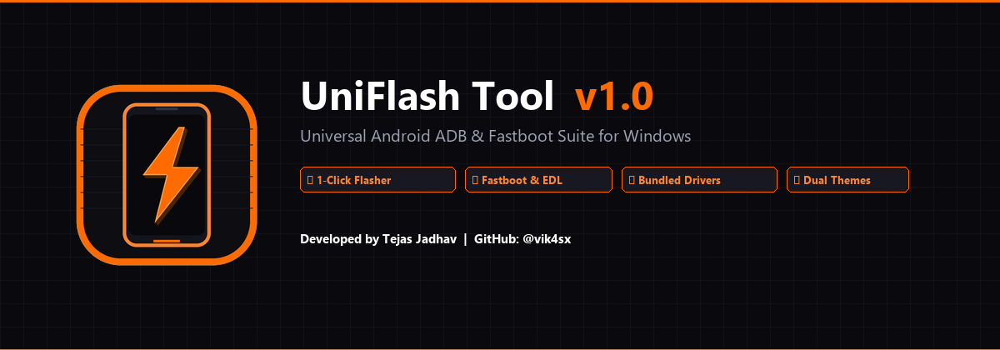

<div align="center">



# UniFlash Tool v1.0 ⚡

**Universal ADB & Fastboot GUI Suite for Android Devices (Windows)**

Developed by: **Tejas Jadhav** • GitHub: [**@vik4sx**](https://github.com/vik4sx)

[](https://github.com/vik4sx/UniFlashTool)
[](https://github.com/vik4sx/UniFlashTool)
[](https://github.com/vik4sx/UniFlashTool)

<br>

[-FF6B00?style=for-the-badge&logo=windows)](https://github.com/vik4sx/UniFlashTool/releases/latest/download/UniFlashTool.exe)

</div>

---

## Key Features
- **Real-Time Device Detection**: Auto-detects connected devices via ADB and Fastboot with live status indicator
- **Driver Installation Hub**: Bundled **15-Second ADB & Fastboot Driver Installer v2.0.7** (1-click direct launch) + official downloads for Qualcomm 9008 EDL, MediaTek VCOM, and all OEM brand drivers + Device Manager integration
-  **Multi Brand Support**:Samsung, Xiaomi, Pixel, OnePlus, Motorola, Realme, OPPO, Vivo, Sony, Asus, Nothing
-  **1-Click Firmware & ROM Flashing**: Sideload and Fastboot partition flashing with real-time logs
-  **Reboot & ADB Controls**: One-click state transitions (Normal, Bootloader, Recovery, Fastbootd, EDL, Sideload, Shell, Server Restart)
-  **Device Backup & Partition Pull**: Full ADB backup/restore and raw partition imaging
-  **Detailed Device Diagnostics**: 29+ hardware & system properties inspector with TXT export

---

## 🛠️ Requirements & Setup

1. **Prerequisites**:
   - Windows 10 or 11
   - Python 3.10+
   - Android platform-tools (ADB & Fastboot) in `tools/platform-tools/` (or installed on system PATH)

2. **Installation**:
   ```bash
   pip install -r requirements.txt
   ```

3. **Launch the Application**:
   ```bash
   python main.py
   ```

4. **Compile to Standalone Windows EXE**:
   Run `build.bat` or execute:
   ```bash
   pyinstaller --onefile --windowed --name="UniFlashTool" main.py
   ```

---

## 👤 Credits & Author
- **Author**: Tejas Jadhav
- **GitHub**: [https://github.com/vik4sx](https://github.com/vik4sx)
